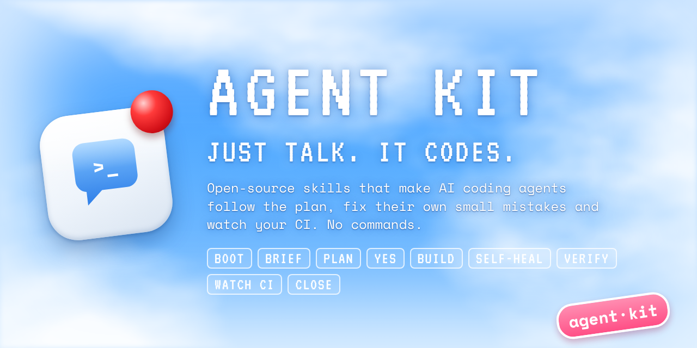

<p align="center">
  
</p>

<p align="center">
  <a href="https://github.com/lucasouzadev/agent-kit-skill/actions/workflows/ci.yml"></a>
  <a href="LICENSE"></a>
  <a href="CHANGELOG.md"></a>
  
  
  
  
</p>

# Agent Kit

**Just talk, it codes.** A mandatory, hook-enforced work track for AI coding agents — Claude Code, Codex, Cursor and any tool that reads `AGENTS.md`. Packaged as a Claude Code plugin and as plain [Agent Skills](https://agentskills.io), installable into any repository with one command.

Agents ignore rules they only *read about*. Agent Kit turns the rules into a **track** that hooks print, check and enforce; lets the agent **fix small defects on its own** (simulator crashed, cache stale, test broken by its own change) instead of stopping to ask; and **watches CI in the background on a light model** so "pushed" becomes "green".

Distilled from production repositories (web + BaaS, React Native/Expo, native iOS/Android, public CI) where agents work daily, and generalized for any stack.

**Contents:** [Why](#why) · [The track](#the-mandatory-track) · [How it is enforced](#how-it-is-enforced) · [Self-heal & CI watch](#self-heal-and-ci-watch-on-a-light-model) · [Install](#install) · [Skills](#skills) · [Docs](#standard-docs) · [FAQ](#faq) · [Contributing](#contributing)

## Why
- **Agents skip the process.** A long `CLAUDE.md` is read once and forgotten; skills are "suggestions". → A short track, re-injected every session and after every compaction, with the required skills named per task and a gate at the end of each turn.
- **Agents stop for trivia.** "The simulator crashed, may I restart it?" ten times a session. → A pre-approved **self-heal envelope**: small, reversible, in-scope defects are fixed without asking, delegated to a cheaper model.
- **"Done" without proof; red PRs left behind.** → Evidence states (PASS / FAIL / BLOCKED / NOT RUN / N/A) and a background **CI watcher** after every push.
- **Boot cost and noise.** → ≤ 120-line `AGENTS.md`, everything else on demand; terse `caveman` replies; early, lossless compaction.

## The mandatory track

| # | Stage | Required skill(s) |
|---|---|---|
| 0 | Boot — `AGENTS.md` + handoff, `git fetch` | `session-guide` |
| 1 | Brief — goal, acceptance, constraints, mode | `intent-compiler` (+ `triage`, `media-investigation`) |
| 2 | Plan — surface, risks, tests first (QUALITY-G1) | `session-preflight`, `spec-driven-development`, `planning-and-task-breakdown` / `systematic-debug` |
| 3 | Owner "yes" — recorded in the handoff | — |
| 4 | Build in thin slices, test first | `incremental-implementation`, `test-driven-development` |
| 5 | **Self-heal** small in-scope failures, no question | `self-heal` → sub-agent `fixer-lite` (light model) |
| 6 | Verify — evidence states (QUALITY-G2) | `code-review-and-quality`, `pr-quality` |
| 7 | **Push + watch CI** in the background | `ci-monitor` → sub-agent `ci-watcher` (light model) |
| 8 | Close — test list, handoff | `handoff` |

Full text: [`TRACK.md`](skills/agent-kit/standard/TRACK.md). `AGENTS.md` overrides every skill, including imported ones.

## How it is enforced

| Layer | Mechanism | What it does |
|---|---|---|
| Always loaded | `AGENTS.md` §0b + `CLAUDE.md` operating contract | The track and the self-heal pre-approval are in the entry points every agent and sub-agent loads |
| `SessionStart` hook | `session-context.sh` | Prints branch, commits, handoff **and the track** on startup, resume and after every compaction |
| `UserPromptSubmit` hook | `intent-brief.sh` | Detects the mode (en/pt/es) and names the **skills to load before acting** (only those installed) |
| `PreToolUse` hooks | `action-guard.sh`, `pr-gate.sh` | Asks before pushes to main, deploys, store builds, destructive SQL, secret reads; blocks PRs whose body fails the quality check |
| `Stop` hook | `track-gate.sh` | A turn that changed files and ends **without evidence states** is sent back once to verify, self-heal and report (never loops) |
| Sub-agents | `fixer-lite`, `ci-watcher` (`model: haiku`) | Mechanical heals and CI watching run on a light model, in the background |
| Other tools | `NO-HOOKS.md`, Cursor rule | The same duties, done by hand |

## Self-heal and CI watch on a light model
- **Heal, don't ask:** lint/type/test failures caused by the change, iOS simulator / Android emulator that won't boot or crashes, Metro/Gradle/Pods/DerivedData caches, busy ports, flaky steps, red CI on the feature branch. Playbook: [`self-heal/playbook.md`](skills/self-heal/playbook.md).
- **Never as a heal:** skipping or weakening tests, `--no-verify`, secrets, production, migrations, releases, the default branch, force-push. Max **2 attempts per cause**, then stop and report.
- **CI:** after every push the main agent starts `ci-watcher` in the background; it runs [`ci_watch.py`](skills/agent-kit/assets/claude/ci_watch.py) (read-only, via `gh`), classifies failures as *infra* (re-run candidate) or *defect* (fix on the same feature branch), and replies `CI: PASS|FAIL|BLOCKED|NOT RUN <url>`.
- Change the light model in `.claude/agents/*.md` (`haiku`, `sonnet` or `inherit`).

## Install

### As a Claude Code plugin
```
/plugin marketplace add lucasouzadev/agent-kit-skill
/plugin install agent-kit@agent-kit
```
Then, inside a repository: *"set up agent-kit in this repo"* — the `agent-kit` skill surveys the repo, proposes a plan and runs the installer with `--no-vendor`.

### Vendored into a repository (cloud sessions, teammates, other tools)
```bash
git clone https://github.com/lucasouzadev/agent-kit-skill
python3 agent-kit-skill/skills/agent-kit/scripts/install.py /path/to/repo --dry-run
python3 agent-kit-skill/skills/agent-kit/scripts/install.py /path/to/repo          # --public-ci for public CI repos
grep -rn '{{' /path/to/repo/AGENTS.md                                               # fill placeholders
```
Use **either** the plugin hooks or the vendored hooks in a repo, not both. Options: `--profile lite|standard|full` · `--pr-quality local|ci` · `--cursor` · `--with-guard` · `.claude/agent-kit/overrides` · `.claude/agent-kit/skip-skills`. Re-running updates only files the kit wrote and you did not edit (hash manifest); existing `AGENTS.md`/`CLAUDE.md` are kept and the installer prints a `hint` to merge the track sections.

**Upgrading from ≤ 1.8?** Re-run the installer (hooks, docs, sub-agents and skills refresh), then merge §0b and the self-heal line into your `AGENTS.md` and the operating contract into `CLAUDE.md` from [`templates/`](skills/agent-kit/templates/).

## Skills

**Workflow & session (kit)**
| Skill | Role |
|---|---|
| `skills/agent-kit/` | setup skill: `templates/`, `standard/` docs, `assets/claude/` (settings, hooks, statusline), `scripts/install.py` |
| `skills/self-heal` | fix small in-scope defects without stopping or asking; simulator/emulator/cache playbook; delegates to `fixer-lite` |
| `skills/ci-monitor` | watch Actions runs after each push on a light model (`ci-watcher`), classify, heal the feature branch |
| `skills/guide-for-beginners` | chat for people who do not code: automatic first-meeting welcome in the person's language, no commands or jargon, the agent decides the technical, asks the folder name for a new project |
| `skills/session-guide` | conversation-led sessions: briefing, goal restatement, one question at a time |
| `skills/intent-compiler` | invisible talk → brief conversion before acting |
| `skills/session-preflight` | session packet before acting |
| `skills/triage` | many asks at once → prioritized list |
| `skills/media-investigation` | attached screenshots/videos: read all of it, report extra findings |
| `skills/systematic-debug` | four-step root cause, two-attempt stop |
| `skills/pr-quality` | honest PRs: template, self-review, local lint, CI check |
| `skills/handoff` | session state file |
| `skills/baton-pass` | continuation prompt for another tool/session when limits are near |
| `skills/caveman` | terse output |

**Quality, security & platforms (kit)**
| Skill | Role |
|---|---|
| `skills/fundamentals-audit` | race, idempotency, client trust, separation, integration tests |
| `skills/ux-check` | UX laws, states, a11y, responsiveness, UI performance |
| `skills/security-core` · `identity-session` · `data-privacy` · `supply-chain` | OWASP Top 10:2025, ASVS 5.0, NIST SP 800-63-4, SSDF, SLSA |
| `skills/performance-core` · `platform-security` | Core Web Vitals, Android vitals, Apple hangs; native, web, WebView, desktop |
| `skills/ci-device-lab` | device lab in GitHub Actions: emulator, simulator, APK/TestFlight, Expo OTA/EAS, Maestro |

**Engineering lifecycle — imported from [addyosmani/agent-skills](https://github.com/addyosmani/agent-skills) (MIT)**
| Skill | Role |
|---|---|
| `spec-driven-development` · `planning-and-task-breakdown` | spec before code; small, ordered tasks |
| `incremental-implementation` · `test-driven-development` | thin verified slices; red-green-refactor |
| `code-review-and-quality` · `code-simplification` | five-axis review; clarity over cleverness |
| `git-workflow-and-versioning` · `ci-cd-and-automation` | branches, commits, conflicts; pipelines and quality gates |
| `api-and-interface-design` · `frontend-ui-engineering` · `browser-testing-with-devtools` | stable interfaces; accessible UIs; real-browser debugging |
| `observability-and-instrumentation` · `shipping-and-launch` · `deprecation-and-migration` · `documentation-and-adrs` | logs/metrics/traces; launches; removals; decisions |
| `source-driven-development` · `doubt-driven-development` | official docs over memory; adversarial review of decisions |

**Build-an-app pack — [Jakeschincariol/replica-skill](https://github.com/Jakeschincariol/replica-skill) (MIT)** · clean-room: rebuild what an app does, never its code, logo, copy or content
| Skill | Role |
|---|---|
| `skills/replica-recon` | reverse-engineer an app's screens, flows, components and data model from public pages, screenshots and your own account |
| `skills/replica-architect` · `replica-design` · `replica-build` · `replica-backend` | stack/schema/API plan; design tokens; screen-by-screen rebuild; auth, database, payments |
| `skills/replica-test` · `replica-diff` | Playwright flow tests and bug reports; parity score and visual diff against the original |
| `skills/replica-entrepreneur` · `replica-brand` · `replica-launch` · `replica-deploy` | what users hate in real reviews; own name and brand; landing page and store listing; ship on your domain |

**Binary & runtime analysis — [morluto/rea](https://github.com/morluto/rea) (MIT)**
| Skill | Role |
|---|---|
| `skills/reverse-engineer-anything` | decompile and compare shipped binaries, APKs, Electron/JS apps and firmware with the REA MCP server (`npx rea-agents setup`); authorized, lawful analysis only (`DISCLAIMER.md`); the kit's approval gate applies before any run against a target |

Both are in the `full` profile only (niche, large). Overlapping upstream skills are mapped to the kit's own (`systematic-debug`, `security-core`, `performance-core`, `session-guide`). Update with [`tools/sync_upstream_skills.py`](tools/sync_upstream_skills.py); notices in [`THIRD_PARTY_NOTICES.md`](THIRD_PARTY_NOTICES.md).

**Profiles** (`profiles.json`): `lite` (14 skills) for small projects · `standard` (28) for apps with real users · `full` (all 51, including the two packs above) when the project builds in CI. Fewer skills = fewer always-loaded tokens.

Also: `output-styles/caveman.md` (terse output style), `hooks/hooks.json` (plugin hooks), `agents/` (light-model sub-agents).

## Standard docs
`TRACK` · `00-MAP` · `MODES` (Fixer, Builder, Product, Architect, Lens, Auditor) · `WORKFLOW` · `QUALITY-GATES` (G1/G2) · `DONE` · `SAFEGUARDS` · `TASK-CONTRACT` · `HANDOFF-TEMPLATE` · `REWORK-LEDGER` · `OWNER-DECISIONS-TEMPLATE` · `ORCHESTRATION` · `THREAT-MODEL` · `CHANGELOG-GUIDE` · `CONTEXT-BUDGET` · `CANARY` · `CONVERSATION` · `NO-HOOKS` · `SECURITY-PERFORMANCE`

## For people who do not code
No `/commands`, no prompts. On the first message of a project the agent greets in 3 lines, in the language the person wrote, and asks one open question; it detects an empty folder (interview → asks the folder name → builds), existing work (asks once to organize it) or a project that already has the kit. From then on every message carries a one-line reminder to stay in plain words (`--audience beginner|dev|auto`, default adapts to how the person writes), so nothing depends on remembering anything. Small problems are fixed silently; results are shown, not code. Details: [`ONBOARDING.md`](skills/agent-kit/standard/ONBOARDING.md). To get the kit without typing commands, commit [`claude-settings.beginner.json`](skills/agent-kit/templates/claude-settings.beginner.json) as `.claude/settings.json` (one trust prompt on first open) or vendor it with the installer.

## More features
- **Meeting-style sessions** (see above): plain talk becomes an invisible brief; no prompt engineering needed.
- **Pass the baton:** statusline shows weekly/5-hour usage; near the limit the agent offers a self-contained continuation prompt for any IDE or model.
- **Early, lossless compaction** at 200k tokens with state re-injection.
- **Approval gate enforced** (`action-guard`): a seatbelt, not a sandbox.
- **PR quality:** template + local linter + optional CI check that fails PRs with unfilled evidence, `PASS` without proof, secrets or `pull_request_target`.
- **Measured:** `python3 .claude/agent-kit/metrics.py report` (counts only, never prompt text), rework hotspots, i18n parity.
- **Trusted hooks:** hash-checked against the install manifest; optional CI guard for `.claude/` changes.

## FAQ
**Does it work without Claude Code?** Yes. Codex, Cursor, Copilot, Gemini CLI and others read `AGENTS.md`; `NO-HOOKS.md` lists the duties to do by hand. Only the automation (hooks, sub-agents, output style) is Claude-specific.

**Will self-heal let the agent do something dangerous?** No. The envelope covers small, reversible, in-scope fixes; secrets, production, migrations, releases, the default branch and test weakening are stop conditions, and `action-guard` still asks before risky commands.

**Does the CI watcher cost a lot?** It runs on `haiku` and spends most of its time in a polling script; the main agent is not blocked.

**Can I turn a gate off?** `AGENT_KIT_TRACK_GATE=0`, `AGENT_KIT_GUARD=0`, or remove a hook from `.claude/settings.json`.

## Notes
- `autoCompactWindow` / `CLAUDE_CODE_AUTO_COMPACT_WINDOW` (100k–1M). If a Claude Code version ignores them from project settings, put them in `~/.claude/settings.json`.
- Plugins cannot set `outputStyle`, `env` or `statusLine`; the installer writes those to the project settings.
- Canary: optional weak signal that the agent loaded the rules (a form of address used in every reply, never written to files).

## Brand
Banner, social images (PT/EN), launch copy and the generator live in [`docs/brand/`](docs/brand/README.md).

## Contributing
Run `bash tests/run.sh` before a PR (CI runs it too). See [CONTRIBUTING.md](CONTRIBUTING.md) and [SECURITY.md](SECURITY.md). License: [MIT](LICENSE).

<sub>Keywords: Claude Code plugin, Claude Code hooks, agent skills, AGENTS.md, CLAUDE.md template, AI coding agent workflow, Codex, Cursor rules, context engineering, self-healing agents, CI monitoring, GitHub Actions, iOS simulator, Android emulator, Expo, React Native, spec-driven development, TDD, code review, OWASP, prompt engineering.</sub>
